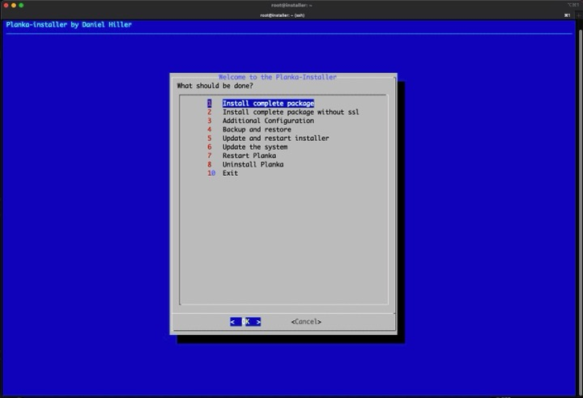

# PLANKA Installer

Install PLANKA with one single command and a few questions.

## READ BEFORE INSTALL

**Do not run this installer on a server that is already in use.**

Since you need a fresh server, use Debian 13 or Ubuntu 26.04 LTS. Other operating systems are not supported.

## Features

- Installs all required packages
- Installs PLANKA
- Configures Nginx reverse proxy
- Automates SSL certificates
- Automates backups
- Automates updates
- Configures Fail2Ban and Firewall
- Creates the first admin user

## Roadmap

- Clean up the code
- Consider additional features

### Supported Operating Systems

| Ubuntu    | Debian    |
|-----------|-----------|
| 26.04 LTS | 13        |

## Installation

Run the following command to start the installation process:

```bash
wget https://raw.githubusercontent.com/plankanban/planka-installer/main/installer.sh -O /opt/planka_installer.sh && bash /opt/planka_installer.sh
```

#### SSL Setup

- You must have a valid DNS entry that points to your server.
- Your server needs to be reachable on ports 80 and 443.
- A valid email address is required for SSL certificates.

## Overview

### Demo
See the installer in action: https://www.youtube.com/watch?v=0Qya8iLDnq0



## Backups
Backups will be stored here:

```bash
/opt/planka/backup
```

You can create a backup or restore one at any time from the "Backup and restore" menu of the installer.

## Logs
Logs can be found here:

```bash
/opt/planka/logs
```

## Uninstalling / Reinstalling

You can reinstall PLANKA using the "Uninstall Planka" option in the installer.

The uninstall option:
- Deletes the PLANKA containers
- Deletes all Docker volumes
- Deletes the Nginx configuration

*Note: Backups are never deleted.*

## Some Notes

- No, I will not support your favorite Linux distribution.
- No, I will not support Windows.
- No pull requests for typo fixes.

## License

[AGPL-3.0 License](https://github.com/plankanban/planka-installer/blob/main/LICENSE)
